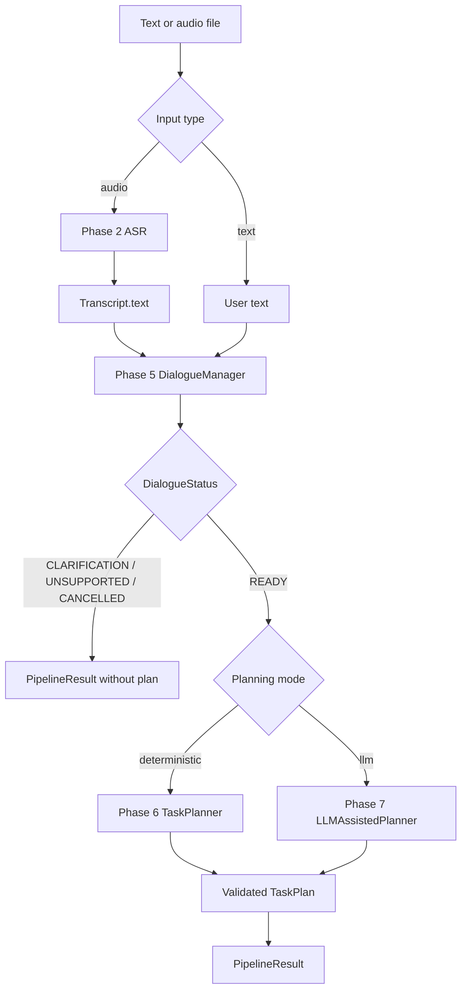

# Intelligent Speech-Controlled Autonomous Mobile Manipulator for Indoor Assistance

Final Year Project for B.Tech Robotics & AI. The robot should turn a natural spoken instruction into a **validated, executable high-level task**, then complete it in an indoor setting (home, hospital, office).

This is not a voice chatbot. Speech is the input; the output of the AI layer is a constrained task the rest of the robot can run.

## My responsibility (Team Member 1)

I own the path from **human speech** to a **validated high-level action sequence**, plus the later interface to ROS 2.

That includes:

- Speech processing (audio, VAD, Faster-Whisper ASR) — **implemented in Phase 2**
- Natural language understanding (intent + entities) — **implemented in Phase 3**
- Structured task representation
- Validation (`VALID` / `INCOMPLETE` / `AMBIGUOUS` / `UNSUPPORTED`) — **implemented in Phase 4**
- Clarification when a command is unsafe to execute — **implemented in Phase 5**
- Context for follow-up commands — **implemented in Phase 5**
- High-level task planning — **implemented in Phase 6**
- Optional LLM-assisted planning **behind** the same schema — **implemented in Phase 7**
- Unified end-to-end AI pipeline — **implemented in Phase 8**
- A mock robot for standalone testing
- The AI ↔ robot ROS 2 contract

I do **not** implement SLAM, Nav2, YOLO, MoveIt, or motor control.

## Team boundaries

| Member | Owns | Receives from me |
|---|---|---|
| **1 — Speech + AI / task intelligence (me)** | Speech → validated high-level actions | — |
| **2 — Navigation** | Base, LiDAR, SLAM, Nav2 | `NAVIGATE(location)` |
| **3 — Vision + manipulation** | Camera, detection, arm, gripper | `SEARCH` / `GRASP` / `DELIVER` |

The LLM must never emit `/cmd_vel`, joint commands, or other hardware control. Invalid structured output is rejected.

## System architecture (target)

```
Human speech
    → audio capture / preprocess / VAD
    → ASR (Faster-Whisper)
    → NLU (intent + entities)          [Phase 3 baseline]
    → validation                       [Phase 4]
    → dialogue / clarification / context [Phase 5]
    → task planner                     [Phase 6 deterministic]
    → optional LLM-assisted planner    [Phase 7]
    → unified pipeline orchestration   [Phase 8]
    → high-level actions
    → mock robot or ROS 2
    → navigation / vision / manipulation
    → execution monitoring / recovery
```

Phase 2 stops at **transcript**. Phase 3 consumes **text**. Phase 4 decides readiness. Phase 5 asks for missing information and merges follow-ups. Phase 6 emits a **symbolic** `TaskPlan`. Phase 7 can propose the same schema via a constrained LLM, then re-validate. Phase 8 wires these stages into one callable pipeline.

## Development environment

- Ubuntu 22.04 LTS
- Python 3.10
- Later ROS 2 target: Humble (not installed or used yet)

Do not source a ROS overlay in this shell. A leftover `PYTHONPATH` from Humble will leak other workspace packages into this project.

## Setup

```bash
cd ~/indoor_robot_ai
source .venv/bin/activate
pip install -r requirements.txt
PYTHONPATH= pytest -v
```

If the virtual environment does not exist:

```bash
# Preferred on Ubuntu 22.04 once the package is installed:
sudo apt install python3.10-venv
python3 -m venv .venv

# Fallback used on this machine (python3-venv was not installed):
uv venv .venv --python python3
source .venv/bin/activate
pip install -r requirements.txt
```

Microphone capture also needs PortAudio:

```bash
sudo apt install libportaudio2
```

File-based transcription works without a microphone.

## Phase 2 — speech processing

Pipeline:

```
audio file or microphone
    → load
    → mono / resample / DC removal / peak normalize
    → energy VAD (reject silence, trim edges)
    → Faster-Whisper
    → Transcript.text
```

Settings live in `config/speech.yaml`. The public object later NLU should use is `Transcript.text`.

### Transcribe a recorded file

```bash
source .venv/bin/activate
PYTHONPATH= python -m src.speech.transcribe path/to/command.wav
PYTHONPATH= python -m src.speech.transcribe path/to/command.wav --json
```

Put your own recordings in `data/raw_audio/` (that folder is gitignored). WAV is the intended format.

The first Faster-Whisper run downloads the model configured in `config/speech.yaml` (`base` by default) into `models/whisper/`. That directory is not committed.

For a quicker first run, set `asr.model_size` to `tiny`.

### Transcribe from the microphone

```bash
PYTHONPATH= python -m src.speech.transcribe --mic --duration 5
PYTHONPATH= python -m src.speech.transcribe --mic --duration 5 --save-recording data/raw_audio/take.wav
```

### Evaluate WER / CER / latency

1. Record real speech files.
2. Copy `data/asr_eval/manifest.example.csv` to `data/asr_eval/manifest.csv`.
3. Add rows: `audio_path,reference`
4. Run:

```bash
PYTHONPATH= python -m src.speech.evaluate --manifest data/asr_eval/manifest.example.csv
PYTHONPATH= python -m src.speech.evaluate --manifest data/asr_eval/manifest.csv --output results/asr/eval.json
```

The example manifest has **no real audio**. The evaluator will skip missing files and will **not** invent WER/CER. Real scores require real recordings and reference transcripts.

### Tests

```bash
PYTHONPATH= pytest -v
```

Ordinary tests do not download Whisper weights and do not use a microphone.

Opt-in real ASR test (downloads a model):

```bash
PYTHONPATH= RUN_ASR_TESTS=1 ASR_TEST_AUDIO=path/to/real_speech.wav pytest -v -m asr
```

## Development phases

1. Project foundation — implemented
2. Speech processing — implemented
3. Command dataset and baseline NLU — implemented
4. Task validation — implemented
5. Dialogue, clarification and context — implemented
6. Deterministic high-level task planning — implemented
7. Optional constrained LLM-assisted planning — implemented
8. Unified end-to-end AI pipeline and mock/dry-run — implemented
9. ROS 2 interface — not yet implemented
10. Integration with navigation, vision and manipulation — not yet implemented
11. Broader system evaluation — pending

## Phase 3 — baseline NLU

NLU is **not** ASR. ASR turns audio into text. NLU turns text into an intent plus grounded entities.

```
typed text or Transcript.text
    → TF-IDF + Logistic Regression intent classifier
    → dictionary / cue entity extractor
    → NLUResult
```

This is a measurable baseline, not a final task-intelligence system. It does not plan, validate, clarify, or control the robot.

### Supported intents

`NAVIGATE`, `RETRIEVE`, `DELIVER`, `FOLLOW`, `STOP`, `RETURN`

Out-of-scope commands are labeled `UNSUPPORTED` (a classifier label, not a seventh robot skill).

### Supported entities

`object`, `source_location`, `destination`, `person`, `action`

Vocabularies live in `config/objects.yaml`, `config/locations.yaml`, `config/persons.yaml`, and `config/nlu.yaml`. Only listed aliases are accepted. Longest alias wins (`kitchen table` is not `kitchen` + `table`). `bottle` is not silently `water_bottle`.

**User references:** `me` / `myself` become `destination=user` only after cues such as `bring me` / `give me`. `take me to the kitchen` treats the **location** as destination, not the user. `follow me` sets `person=user`. These rules are in `config/nlu.yaml`.

### Dataset

Hand-authored development set in `data/nlu/` (see `data/nlu/README.md`). Not a real-world benchmark.

- `train.jsonl` — classifier training
- `test.jsonl` — unseen phrasings
- No overlapping sentences after normalization

### How to test arbitrary text

```bash
source .venv/bin/activate
PYTHONPATH= python -m src.nlu --retrain "Can you take me to the kitchen?"
PYTHONPATH= python -m src.nlu --retrain "Please bring me the water bottle from the kitchen."
```

`--retrain` fits on `data/nlu/train.jsonl` in memory. To save a model:

```bash
PYTHONPATH= python -m src.nlu.train
PYTHONPATH= python -m src.nlu "Follow me."
```

Later ASR wiring (not required for Phase 3):

```python
from src.speech import transcribe_file
from src.nlu import parse

text = transcribe_file("data/raw_audio/command.wav").text
result = parse(text)
```

### Evaluation

```bash
PYTHONPATH= python -m src.nlu.evaluation
```

Writes `results/nlu/eval.json` with intent accuracy, per-class scores, a confusion matrix, and entity precision/recall/F1 on the **held-out test split**. Scores are development metrics only.

### Tests

```bash
PYTHONPATH= pytest -v
```

### Current limitations

- Small synthetic text set; do not claim real-world generalization
- Entity extractor is alias + cue rules, not neural NER
- Action words such as `take` can match `navigate` even in unrelated sentences
- Softmax confidence on paraphrases is often below 0.4; Phase 3 reports it but does not rewrite the label

## Phase 4 — task validation

NLU asks what the user appears to mean. Validation asks whether that interpretation is complete and acceptable to send to a **future** planner. Validation does not talk to the user and does not move the robot.

```
from src.nlu import parse
from src.validation import validate

result = validate(parse("Bring me the bottle."))
# result.status == INCOMPLETE
# result.missing_entities == ["source_location"]
```

### Statuses

| Status | Meaning |
|---|---|
| `VALID` | Supported intent, required entities present and in catalog, no unresolved ambiguity |
| `INCOMPLETE` | Intent is usable, but a required slot was never provided |
| `AMBIGUOUS` | Competing robot intents, conflicting values, or an ungrounded reference (`there`, `it`, …) |
| `UNSUPPORTED` | Not a robot skill, or a filled slot is not in the configured catalog |

Priority: UNSUPPORTED intent/catalog → competing intents → deixis/conflicts → missing slots → VALID.

### Required entities

Defined only in `config/validation.yaml`:

| Intent | Required |
|---|---|
| NAVIGATE | destination |
| RETRIEVE | object, source_location, destination |
| DELIVER | object, **and** person or destination |
| FOLLOW | person |
| STOP | (none) |
| RETURN | destination |

`destination=user` is allowed. It is the explicit user-reference value, not a map location.

### Confidence policy

Phase 3 softmax values are **not** real-world certainty. Validation does **not** do `if confidence < 0.40: UNSUPPORTED`.

`competing_margin` (default 0.05) flags AMBIGUOUS only when the top two **robot** intents are closer than that margin. A lone low score with a clear winner (e.g. FOLLOW 0.22 vs RETRIEVE 0.10) stays VALID if slots are complete.

### Examples

| Text | Status |
|---|---|
| Take me to the kitchen. | VALID |
| Follow me. / Stop. | VALID |
| Bring me the bottle from the kitchen. | VALID |
| Bring me the bottle. | INCOMPLETE (`source_location`) |
| Go there. | not VALID. Designed path: NAVIGATE + `there` → AMBIGUOUS destination. Live Phase 3 currently predicts STOP with competing RETURN → also AMBIGUOUS |
| What's the weather today? | UNSUPPORTED |

### Manual check

```bash
PYTHONPATH= python -m src.validation "Bring me the bottle."
PYTHONPATH= python -m src.validation "Take me to the kitchen."
PYTHONPATH= python -m src.nlu.evaluation
PYTHONPATH= python -m src.validation.evaluation
```

### Current limitations

- Small hand-authored eval set; not a real-world benchmark
- Deixis list is a fixed word list, not a coreference model
- Unknown objects are only seen if NLU actually emits them (live speech usually just omits the slot → INCOMPLETE)

## Phase 5 — dialogue / clarification / context

NLU interprets one utterance. Validation checks completeness. Dialogue asks for missing information and merges short follow-ups into the **same** structured task.

```
from src.dialogue import DialogueManager

manager = DialogueManager()
r1 = manager.process("Bring me the bottle.")
# CLARIFICATION_REQUIRED → "Where should I get the bottle from?"
r2 = manager.process("From the kitchen.")
# READY → RETRIEVE object=bottle source_location=kitchen destination=user
```

Does **not** plan actions, call an LLM, or control the robot.

### Statuses

| Status | Meaning |
|---|---|
| `READY` | Latest validation is VALID — task can go to a future planner |
| `CLARIFICATION_REQUIRED` | One targeted question; awaiting answer |
| `UNSUPPORTED` | Outside robot skills — no clarification loop |
| `CLARIFICATION_FAILED` | Exceeded `max_clarification_turns` |
| `CANCELLED` | User said STOP while a task was pending |

### How context works

`DialogueState` keeps the active `NLUResult`, pending slots, clarification count, last question, and a bounded turn log (`history_size` in `config/dialogue.yaml`). Entities are merged structurally — utterances are never concatenated for reclassification.

### Clarification

Templates live in `config/dialogue.yaml`. One question per turn for the first pending slot (from Phase 4 `missing_entities` / `ambiguous_entities`).

### Follow-up resolution (deterministic)

While awaiting clarification:

1. **STOP** (VALID) → `CANCELLED`
2. Else if the text fills a pending slot (catalog / cues / bare `me`→`user`) → **merge** + `validate()` again
3. Else if the text is a VALID robot command that did not fill the pending slot → **replace** pending task
4. Else → re-ask (counts toward the clarification limit)

So `"The kitchen."` during a RETRIEVE clarification becomes `source_location=kitchen`, not a new NAVIGATE.

### Manual check

```bash
PYTHONPATH= python -m src.dialogue "Bring me the bottle."
PYTHONPATH= python -m src.dialogue --interactive
PYTHONPATH= python -m src.dialogue.evaluation
```

### Evaluation

Hand-authored multi-turn scenarios in `data/dialogue/eval.jsonl`. Development metrics only — not a real-world benchmark.

### Current limitations

- Short answers must still hit configured catalogs (or bare `me`/`myself`)
- `"Go there."` depends on Phase 3/4; dialogue will not invent a destination
- No general conversational memory beyond the active pending task
- No LLM paraphrasing of questions

## Phase 6 — deterministic high-level task planning

Phase 5 produces a READY validated task. Phase 6 turns that task into an ordered list of **symbolic** high-level actions. It does not move the robot, call ROS 2, or use an LLM.

```
from src.dialogue import DialogueManager
from src.planning import TaskPlanner

manager = DialogueManager()
ready = manager.process("Take me to the kitchen.")
plan = TaskPlanner().plan(ready)
# plan.status == PLANNED
# plan.actions == [NAVIGATE_TO(destination=kitchen)]
```

### Input gating

`TaskPlanner.plan(dialogue_result)` accepts only `DialogueStatus.READY`. Non-READY statuses (`CLARIFICATION_REQUIRED`, `CLARIFICATION_FAILED`, `CANCELLED`, `UNSUPPORTED`) return `PlanningStatus.REJECTED`. If a `ValidationResult` is attached, it must be `VALID`.

For unit tests and evaluation, `plan_task(intent, entities)` plans from an explicit structured task without dialogue.

### TaskPlan schema

| Field | Meaning |
|---|---|
| `status` | `PLANNED` / `REJECTED` / `UNSUPPORTED` / `FAILED` — **planning** outcome, not execution |
| `intent` | Canonical intent from the READY task |
| `entities` | Canonical entity map used for planning |
| `actions` | Ordered `PlannedAction` list |
| `errors` / `warnings` | Failure reasons or documented assumptions |
| `explanation` | Short human-readable summary |

Each `PlannedAction` has `id`, `type`, `parameters` (string→string), `order`, `depends_on`, and `description`. Use `plan.to_dict()` for JSON.

### Action vocabulary

Defined in `src/planning/action_registry.py` (symbolic only):

| Action | Required parameters | Purpose |
|---|---|---|
| `NAVIGATE_TO` | `destination` | Go to a named map location |
| `NAVIGATE_TO_USER` | — | Go to the requesting user |
| `NAVIGATE_TO_PERSON` | `person` | Go to a named person |
| `SEARCH_OBJECT` | `object`, `location` | Search for an object at a location |
| `APPROACH_OBJECT` | `object` | Approach for manipulation |
| `GRASP_OBJECT` | `object` | Grasp with the arm/gripper |
| `DELIVER_OBJECT` | `object` (+ optional `destination` / `person`) | Hand over or place |
| `FOLLOW_PERSON` | `person` | Follow a person |
| `STOP` | — | Symbolic stop request |

### Intent → plan mapping

| Intent | High-level sequence |
|---|---|
| NAVIGATE | `NAVIGATE_TO` (or `NAVIGATE_TO_USER` if destination=`user`) |
| RETURN | `NAVIGATE_TO` |
| FOLLOW | `FOLLOW_PERSON` |
| STOP | `STOP` |
| RETRIEVE | navigate → search → approach → grasp → navigate to dest/user → deliver |
| DELIVER | navigate to person/user/location → deliver (**assumes object already held**) |
| UNSUPPORTED | `PlanningStatus.UNSUPPORTED` — no executable plan |

Config: `config/planning.yaml` (`plannable_intents`, `user_destination_value`, `deliver_assumes_object_held`).

### Plan validation

`validate_plan` checks supported action types, required parameters, unique IDs, valid dependency references, no self-deps, no cycles, and dependency order. It does **not** check free paths, grasp feasibility, localization, or object visibility.

### Manual check

```bash
PYTHONPATH= python -m src.planning "Take me to the kitchen."
PYTHONPATH= python -m src.planning "Bring me the bottle from the kitchen." --json
PYTHONPATH= python -m src.planning.evaluation
PYTHONPATH= pytest -v tests/planning
```

### Example output

```text
dialogue_status: READY
status: PLANNED
intent: NAVIGATE
explanation: NAVIGATE → go to kitchen.
actions:
  1. NAVIGATE_TO {'destination': 'kitchen'}
```

### Known limitations

- Symbolic plans only — no Nav2, MoveIt, vision, or motor execution
- DELIVER assumes the object is already held (grasp state is not tracked in Phases 1–5)
- No coordinates, trajectories, or grasp poses are invented
- Plan validity ≠ physical executability
- Hand-authored eval set is a development check, not a real-world benchmark

### Team assumptions (need agreement)

| Topic | Assumption | Owner |
|---|---|---|
| Location IDs | Canonical location strings map to Nav2 waypoints later | Member 2 |
| `destination=user` / `NAVIGATE_TO_USER` | User pose comes from a future localization / follow source | Members 1–2 |
| SEARCH / APPROACH / GRASP | Vision + MoveIt will interpret these symbols | Member 3 |
| DELIVER without source | Object already held unless a later state layer says otherwise | Members 1 + 3 |
| STOP | Real e-stop / cancel belongs to the execution safety layer | Members 2–3 |

### Future ROS 2 boundary

A later execution bridge should consume `TaskPlan.to_dict()` and map each `ActionType` to Nav2 / MoveIt / skill interfaces. Phase 6 stops at the plan representation.

## Phase 7 — constrained LLM-assisted planning

Phase 6 remains the **deterministic baseline**. Phase 7 adds an optional LLM path that proposes a plan in the **same** `TaskPlan` schema, then runs grounding + Phase 6 `validate_plan` before acceptance.

```
DialogueResult (READY only)
  → LLMAssistedPlanner
  → provider.complete(prompt)
  → parse JSON → TaskPlan
  → catalog grounding
  → validate_plan (Phase 6)
  → LLMPlanningResult
```

The LLM never executes actions, never publishes ROS topics, and never bypasses validation.

### Modes

| Mode | Component | Credentials |
|---|---|---|
| `DETERMINISTIC` | Phase 6 `TaskPlanner` | None |
| `LLM_ASSISTED` | `LLMAssistedPlanner` + provider | Only for live `openai_compatible` |

```python
from src.dialogue import DialogueManager
from src.llm_planning import LLMAssistedPlanner, FakeLLMProvider

manager = DialogueManager()
ready = manager.process("Take me to the kitchen.")
provider = FakeLLMProvider([valid_json_string])
result = LLMAssistedPlanner(provider=provider).plan(ready)
# result.plan  → Phase 6 TaskPlan
# result.mode  → LLM_ASSISTED or DETERMINISTIC (if fallback)
```

### Provider setup

Config: `config/llm_planning.yaml`

| Key | Meaning |
|---|---|
| `provider` | `fake` (default) or `openai_compatible` |
| `api_base_url` / `model` | OpenAI-compatible chat completions |
| `api_key_env` | Env var name for the API key (default `OPENAI_API_KEY`) |
| `max_correction_attempts` | Bounded re-ask after validation failure (default 1) |
| `fallback_to_deterministic` | If true, Phase 6 may run after LLM failure (default **false**) |

Live calls:

```bash
export OPENAI_API_KEY=...   # never commit this
PYTHONPATH= python -m src.llm_planning "Take me to the kitchen." --mode llm --live --json
```

Offline / CI (no network):

```bash
PYTHONPATH= python -m src.llm_planning "Take me to the kitchen." --mode deterministic
PYTHONPATH= python -m src.llm_planning "Take me to the kitchen." --mode llm --fake-response /path/to/plan.json
```

No new Python packages are required for Phase 7 (stdlib `urllib` for the HTTP client).

### Safety boundaries

- Only `DialogueStatus.READY` (+ `ValidationStatus.VALID` when attached) is planned
- Allowed actions come from `src/planning/action_registry.py`
- Entity values must be in configured object/location/person catalogs
- Malformed JSON, unknown actions, bad dependencies, and cycles are rejected
- Correction retries are bounded; failures do not invent a successful plan
- Optional deterministic fallback is explicit (`fallback_used=true`, `mode=DETERMINISTIC`)

### Evaluation

Hand-authored offline set in `data/llm_planning/eval.jsonl` with scripted `FakeLLMProvider` responses. Compares structural action sequences to Phase 6 where appropriate.

```bash
PYTHONPATH= python -m src.llm_planning.evaluation
PYTHONPATH= pytest -v tests/llm_planning
```

This is **not** a live-model benchmark. Live performance is only measured with `--live` and is not fabricated when credentials are absent.

### Known limitations

- Default config uses `fake` — no real LLM quality claims without `--live`
- DELIVER still has no grasp-state tracking (same Phase 6 limitation)
- Symbolic plan ≠ physical executability
- Small hand-authored eval set only
- No ROS 2, Nav2, MoveIt, or motor control in this phase

## Phase 8 — unified end-to-end AI pipeline

Phase 8 orchestrates Phases 2–7. It does **not** reimplement NLU, validation, dialogue, or planning. It produces a symbolic `TaskPlan` only — no robot motion.



### Sessions (multi-turn)

```python
from src.pipeline import AIPipeline

pipeline = AIPipeline()
session = pipeline.new_session()          # isolated conversation
r1 = pipeline.run_text("Bring me the bottle.", session=session)
# CLARIFICATION_REQUIRED — planners are not called
r2 = pipeline.run_text("From the kitchen.", session=session)
# PLANNED RETRIEVE plan
session.reset()                           # clear pending state
```

Create a **new** `PipelineSession` per independent conversation. Do not share one session across unrelated users.

### CLI

```bash
# Deterministic (no API key)
PYTHONPATH= python -m src.pipeline --text "Take me to the kitchen" --mode deterministic

# Offline LLM path with a scripted JSON plan
PYTHONPATH= python -m src.pipeline --text "Take me to the kitchen" --mode llm --fake-response plan.json --json

# Audio file (uses Phase 2 ASR; needs model weights)
PYTHONPATH= python -m src.pipeline --audio data/raw_audio/example.wav --mode deterministic

# Tests / offline evaluation
PYTHONPATH= pytest -v tests/pipeline
PYTHONPATH= python -m src.pipeline.evaluation
```

Exactly one of `--text` or `--audio` is required. `--live` / `--fake-response` apply only to `--mode llm`.

### PipelineResult fields

| Field | Source |
|---|---|
| `status` | High-level pipeline outcome (`PLANNED`, `CLARIFICATION_REQUIRED`, …) |
| `intent` / `entities` | From `DialogueResult.task` |
| `validation_status` / `dialogue_status` | Phases 4–5 |
| `clarification_question` / `pending_slots` | Phase 5 when clarifying |
| `planning_mode` / `plan` | Phase 6 or 7, only after READY |
| `timings` | Monotonic ms for stages that ran (`asr_ms` only for audio) |

### Evaluation metrics (offline development set)

Defined on `data/pipeline/eval.jsonl` with deterministic + fake-LLM modes:

| Metric | Meaning |
|---|---|
| `end_to_end_success_rate` | Fraction of cases matching all labeled expectations |
| `intent_accuracy` | Among cases with `expected_intent` |
| `dialogue_status_accuracy` | Among cases with `expected_dialogue_status` |
| `plan_sequence_accuracy` | Among cases with `expected_action_types` |
| `mean_total_latency_ms` | Mean pipeline wall time for evaluated cases |

This is a **hand-authored development set**, not a real-world speech or robot benchmark.

### Frozen NLU v2 evaluation

The family-aware frozen dataset contains 416 train, 79 dev, 90 in-domain test, 55 paraphrase test, and 60 OOS test utterances. The generated corpus is mostly synthetic templates/paraphrases; it is not real-user data. RETRIEVE has 77 train examples versus 151 NAVIGATE examples. This imbalance is retained because the corpus has naturally different intent counts; class-weighted Logistic Regression is used instead of deleting examples or forcing equal counts.

The saved TF-IDF v2 artifact (`models/nlu/intent_tfidf_lr_v2.joblib`) was evaluated without retraining on the frozen test splits. Fresh evaluation during the audit reported:

| Split | N | Accuracy | Macro-F1 | OOS precision / recall | OOS false accepts |
|---|---:|---:|---:|---:|---:|
| In-domain | 90 | 0.911 | 0.888 | 0.667 / 0.800 | 1 |
| Paraphrase | 55 | 0.891 | 0.853 | 0.875 / 0.778 | 2 |
| OOS-heavy | 60 | 0.950 | 0.972 | 1.000 / 0.824 | 3 |

The full per-class scores and confusion matrices are in `results/nlu_v2/audit_evaluation.json`. Slot exact-value micro-F1 was 0.937 in-domain, 0.911 on paraphrases, and 0.953 on OOS-heavy data. These are synthetic text results, not ASR accuracy.

An earlier recorded comparison in `results/nlu_v2/model_comparison.json` selected MiniLM + Logistic Regression by dev macro-F1 (0.963 vs TF-IDF 0.867). On the frozen tests, MiniLM scored macro-F1 0.915 in-domain, 0.919 paraphrase, and 0.861 OOS-heavy; TF-IDF scored 0.888, 0.853, and 0.972. The default remains TF-IDF because it is locally loadable and the embedding result traded OOS rejection quality for paraphrase/in-domain quality. The MiniLM artifact contains the trained head but no loadable local encoder checkpoint; loading tried Hugging Face and failed on DNS, so the embedding comparison could not be independently rerun offline. The installed `sentence-transformers` package alone does not make the backend offline-ready.

### Dry-run simulation boundary

```bash
PYTHONPATH= .venv/bin/python -m src.simulation.dry_run "Take me to the kitchen." --json
```

The Python adapter also exposes `DryRunAdapter.run_audio(path)` for recorded audio files; it sends the ASR transcript through the same plan-validation gate. There is no microphone capture in the normal demo/test path.

The adapter accepts a planned `TaskPlan` only after checking plan structure, required action parameters, and catalog IDs. It records intended operations and returns `DRY_RUN_ACCEPTED` or `REJECTED`; `success` means the symbolic plan passed the dry-run checks, not that a robot moved. `would_execute` remains false and no ROS publishers are created. STOP is logged as an explicit symbolic STOP operation.

The dialogue gate rejects explicit unknown destination/object names as UNSUPPORTED (for example, “go to Narnia”), while unresolved references such as “go there” remain clarification cases. Missing required fields such as a retrieval source still request clarification.

A separate local workspace, `instrument_robot_ws`, is a **surgical instrument-delivery** simulator, not the household-assistance robot. Read-only inspection found Nav2 `BasicNavigator`, `/cmd_vel` (`geometry_msgs/msg/Twist`), `/arm_position_controller/follow_joint_trajectory` (`control_msgs/action/FollowJointTrajectory`), `/ATTACHLINK` and `/DETACHLINK` (`linkattacher_msgs` services), and `/surgery_request` (`std_msgs/msg/String`). Its tray attachment is not a household grasp API; no household locations, detector contract, or grasp action are available. No interface is connected from this repository, and no simulation or robot motion was run.

### Known limitations

- Symbolic plans only — no Nav2 / MoveIt / gripper execution
- ASR audio path needs Whisper weights; unit tests mock ASR
- Live LLM calls are optional and not used in offline eval
- DELIVER still assumes the object may already be held (Phase 6 limitation)
- `"Go there."` follows live Phase 3/4 ambiguity → clarification; no invented destination
- No labeled audio fixtures are available for WER/CER evaluation; the two real-ASR tests are opt-in/skipped by default

### Remaining for ROS 2 integration (future)

For a matching household simulation, define household location IDs/poses, a perception and grasp contract, and a STOP/safety contract. Only then map `ActionType` values to ROS interfaces. Do not reuse the surgical tray-attach service as grasping. Add execution monitoring and test the ROS bridge independently from NLU/planning.

## What is intentionally not implemented yet

Household robot execution, Nav2/MoveIt integration for this project's task schema, household perception/grasp, and a physical mock-robot loop. The separate surgical simulator is not an integrated target.
